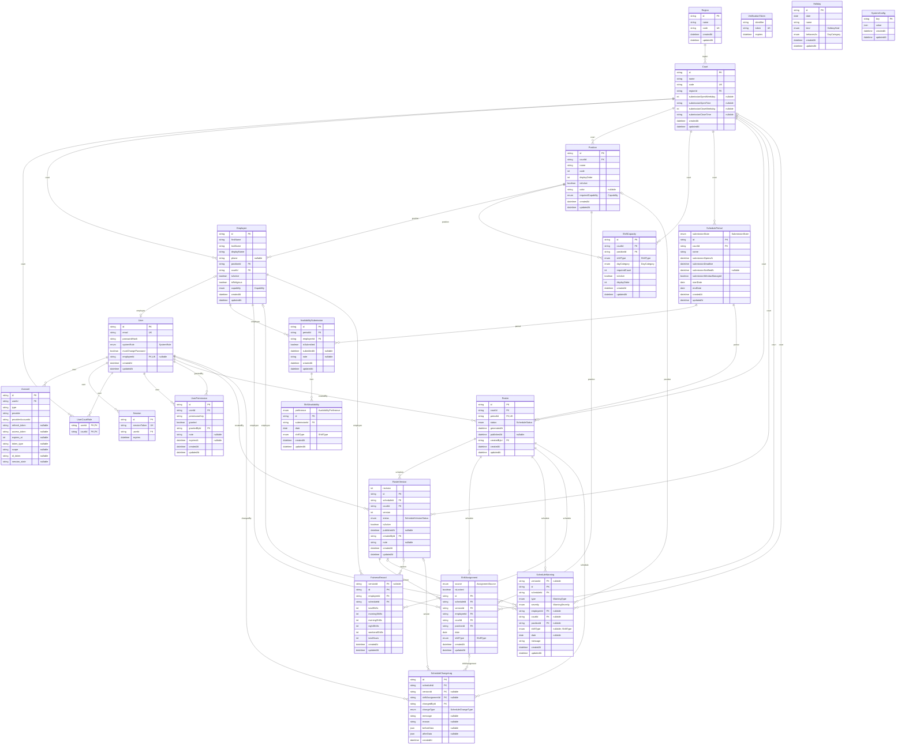

# סכמה מלאה — יעד לפי התוכנית שאושרה

התרשים שומר על `Region` ו־`Court`, בהתאם לתוכנית שאושרה. בעת יצירתו, בקובץ המקור הופיעו הכותרות `District` ו־`Facility` אך הקשרים עדיין הפנו לשמות הקודמים. זהו תיעוד יעד; קובץ הסכמה לא שונה. ניהול מחוזי אינו כלול.

כל 22 המודלים וכל השדות הסקלריים מוצגים. `PK` מפתח ראשי, `FK` מפתח זר, `UK` ייחודיות בשדה יחיד. מפתחות מורכבים ואינדקסים מפורטים בהמשך. `nullable` מציין שדה אופציונלי. קווים מתארים קשרי מסד בלבד; ל־Holiday ול־SystemConfig אין קשרי FK.



## ערכים מותרים

- `Capability`: `GUARD`, `CONTROLLER`, `SHIFT_MANAGER`
- `AvailabilityPreference`: `AVAILABLE`, `PREFERRED`, `UNAVAILABLE`
- `SubmissionState`: `SCHEDULED`, `OPEN`, `CLOSED`
- `AssignmentSource`: `MANUAL`, `AUTOMATIC`
- `SystemRole`: `EMPLOYEE`, `MANAGER`, `ADMIN`
- `ScheduleChangeType`: `CREATE`, `UPDATE`, `DELETE`, `PUBLISH`, `MANUAL_OVERRIDE`
- `ShiftType`: `MORNING`, `EVENING`, `NIGHT`
- `ScheduleVersionStatus`: `DRAFT`, `PUBLISHED`, `ARCHIVED`
- `DayCategory`: `WEEKDAY`, `FRIDAY`, `SATURDAY`
- `HolidayKind`: `EVE`, `HOLIDAY`, `SPECIAL_DAY`
- `ScheduleStatus`: `DRAFT`, `OPEN`, `LOCKED`, `PUBLISHED`, `ARCHIVED`
- `WarningType`: `UNDERSTAFFED`, `UNFILLED`, `MIN_NOT_MET`, `CONFLICT`, `FAIRNESS`
- `WarningSeverity`: `ERROR`, `WARNING`, `INFO`

## מפתחות מורכבים ואינדקסים

ייחודיות בשדה יחיד כבר מסומנת בתרשים. הגדרות Prisma ברמת המודל:

### Account

```prisma
@@unique([provider, providerAccountId])
```

### VerificationToken

```prisma
@@unique([identifier, token])
```

### User

```prisma
@@index([systemRole])
```

### UserCourtRole

```prisma
@@id([userId, courtId])
@@index([courtId])
```

### UserPermission

```prisma
@@unique([userId, permissionKey])
@@index([userId])
@@index([grantedById])
```

### Court

```prisma
@@index([regionId])
```

### Employee

```prisma
@@unique([id, courtId])
@@index([courtId])
@@index([courtId, isActive])
@@index([positionId])
@@index([positionId, courtId])
```

### Position

```prisma
@@unique([courtId, name])
@@unique([courtId, code])
@@unique([id, courtId])
@@index([courtId])
@@index([courtId, displayOrder])
```

### ShiftCapacity

```prisma
@@unique([courtId, positionId, shiftType, dayCategory])
@@index([courtId, isActive])
@@index([courtId, shiftType, dayCategory])
@@index([positionId])
@@index([positionId, courtId])
@@index([courtId, displayOrder])
```

### Holiday

```prisma
@@unique([date])
@@index([behavesAs])
```

### AvailabilitySubmission

```prisma
@@unique([periodId, employeeId])
@@index([employeeId])
@@index([periodId])
```

### ShiftAvailability

```prisma
@@unique([submissionId, date, shiftType])
@@index([date, shiftType])
```

### SchedulePeriod

```prisma
@@unique([id, courtId])
@@index([courtId])
@@index([courtId, endDate])
@@index([courtId, startDate, endDate])
@@index([startDate, endDate])
```

### Roster

```prisma
@@unique([id, courtId])
@@unique([periodId, courtId])
@@index([courtId])
@@index([status])
@@index([courtId, status])
@@index([createdById])
```

### RosterVersion

```prisma
@@unique([id, scheduleId, courtId])
@@unique([scheduleId, version])
@@index([scheduleId])
@@index([courtId])
@@index([status])
@@index([isActive])
@@index([scheduleId, status, isActive, version])
```

### ShiftAssignment

```prisma
@@unique([versionId, employeeId, date, shiftType])
@@index([scheduleId])
@@index([versionId])
@@index([versionId, date])
@@index([versionId, date, shiftType, positionId])
@@index([scheduleId, date])
@@index([scheduleId, courtId])
@@index([employeeId, courtId])
@@index([positionId, courtId])
@@index([employeeId, date])
@@index([courtId, date])
@@index([positionId])
@@index([shiftType])
```

### ScheduleWarning

```prisma
@@index([versionId])
@@index([scheduleId, date])
@@index([employeeId, date])
@@index([courtId, date])
@@index([positionId, date])
@@index([shiftType])
```

### FairnessRecord

```prisma
@@unique([employeeId, versionId])
@@index([versionId])
@@index([scheduleId])
```

### ScheduleChangeLog

```prisma
@@index([scheduleId, createdAt])
@@index([versionId, createdAt])
@@index([shiftAssignmentId])
@@index([changedById, createdAt])
```

## כללים שאינם נראים בקשרי ER

- מיגרציות SQL מוסיפות אינדקסים חלקיים: טיוטה אחת וגרסה מפורסמת נוכחית אחת לכל שיבוץ.
- `revision` משמש למניעת דריסת עריכה; `version` הוא מספר גרסת השיבוץ.
- `source` ו־`isLocked` מפרידים בין מקור האיוש לבין נעילה.
- טריגרים מגינים על גרסאות מפורסמות ועל היסטוריית השינויים.
- `UserCourtRole` הוא שיוך ללא שדה תפקיד; ההרשאות מסתמכות גם על `User.systemRole` ובדיקות שרת.
- `Capability` הוא enum ולא טבלה: GUARD < CONTROLLER < SHIFT_MANAGER.
- `SchedulePeriod.submissionState` מנהל הגשות בנפרד ממצב הפרסום. `Roster.status` נשמר לתאימות לתצוגה הקיימת.
- `ScheduleWarning.versionId` ו־`FairnessRecord.versionId` עדיין nullable בסכמה; תוצאות החישוב החדשות נכתבות לפי גרסה.

מקור: [schema.prisma](../prisma/schema.prisma), [תיעוד המימוש](scheduling-architecture.md).
